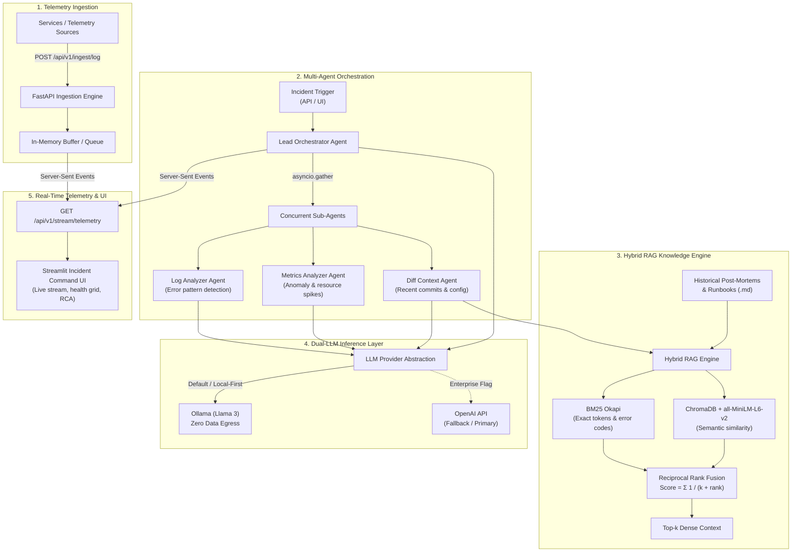

# 🛡️ SentinelCore

> **A production-grade, local-first Incident Command & Automated Root Cause Analysis (RCA) system.**

SentinelCore automates incident triage during critical system outages. Instead of engineers manually sifting through scattered stack traces, server metrics, and git history under high pressure, SentinelCore ingests telemetry in real time, coordinates specialized diagnostic AI agents in parallel, searches historical incident post-mortems using a hybrid RAG engine, and streams live investigation findings to an interactive command dashboard.

Built local-first to ensure sensitive system telemetry, PII, and credentials never leave enterprise boundaries, with optional enterprise cloud LLM support.

---

## 📑 Table of Contents
- [System Architecture](#-system-architecture)
- [How It Works (Workflow)](#-how-it-works-workflow)
- [Key Architectural Decisions & Tradeoffs](#-key-architectural-decisions--tradeoffs)
- [Multi-Agent Diagnostic System](#-multi-agent-diagnostic-system)
- [Hybrid RAG Engine & RRF](#-hybrid-rag-engine--reciprocal-rank-fusion)
- [Resilience & Edge Cases Handled](#-resilience--edge-cases-handled)
- [Enterprise Scaling Roadmap](#-enterprise-scaling-roadmap)
- [Project Directory Structure](#-project-directory-structure)
- [API Reference](#-api-reference)
- [Getting Started](#-getting-started)
- [Configuration](#-configuration)

---

## 🏗️ System Architecture



---

## ⚡ How It Works (Workflow)

1. **Telemetry Ingestion:** External services and microservices push structured application logs, error payloads, and alerts to `POST /api/v1/ingest/log`. Logs are buffered asynchronously to decouple ingestion throughput from downstream AI inference.
2. **Incident Trigger:** When an alert fires or an engineer submits an incident description (e.g., *"Database connection timeouts on checkout service following deployment"*), the `LeadOrchestrator` agent initializes the diagnostic pipeline.
3. **Parallel Sub-Agent Investigation:** Using Python's `asyncio.gather()`, the orchestrator immediately fans out investigation tasks across three specialized agents:
   - **Log Analyzer Agent:** Scans recent error logs, isolates exceptions, and categorizes error severity.
   - **Metrics Analyzer Agent:** Examines CPU, memory, and database connection pool utilization for correlated anomalies.
   - **Diff Context Agent:** Cross-references recent code commits against the **Hybrid RAG Engine**, pulling relevant historical post-mortems and past runbooks.
4. **Hybrid RAG Retrieval:** The RAG engine executes concurrent searches across vector embeddings (semantic match) and BM25 (exact error code match), fusing results with Reciprocal Rank Fusion (RRF) to pass high-density context into the prompts without exceeding token limits.
5. **Synthesis & RCA Generation:** The Lead Orchestrator aggregates all sub-agent findings and synthesizes a structured Markdown Root Cause Analysis (RCA) report with root cause identification, mitigation steps, and a confidence score.
6. **Live Streaming:** All intermediate agent thoughts, ingested logs, and the final RCA are pushed to the frontend in real time via **Server-Sent Events (SSE)**.

---

## ⚖️ Key Architectural Decisions & Tradeoffs

Engineering production software is fundamentally an exercise in navigating tradeoffs. Here is the rationale behind each core technical decision in SentinelCore:

### 1. Hybrid RAG (Vector + BM25 with RRF) vs. Pure Vector Search
* **The Problem with Pure Vector Search:** Dense vector embeddings (e.g., embeddings from `all-MiniLM-L6-v2`) excel at semantic queries (e.g., matching *"database is unreachable"* with *"postgres connection dropped"*). However, in production debugging, incidents frequently hinge on **exact tokens**—such as specific error codes (`ERR_CONN_TIMEOUT_504`), transaction IDs, function names (`acquire_connection_pool`), or table names. Vector databases routinely fail on exact token searches because uncommon strings get lost in high-dimensional vector space.
* **Our Decision:** Implemented a two-pronged retrieval model combining **BM25 Okapi** (lexical keyword matching) and **ChromaDB** (dense semantic vector matching), fused via **Reciprocal Rank Fusion (RRF)** with standard hyperparameter $k=60$:
  $$\text{RRF Score}(d) = \sum_{m \in \{\text{BM25}, \text{Vector}\}} \frac{1}{k + \text{rank}_m(d)}$$
* **Tradeoff:** Slightly higher memory footprint at startup (loading the BM25 index alongside ChromaDB), but delivers significantly higher precision for technical incident diagnostics and completely prevents token hallucination on error codes.

### 2. Server-Sent Events (SSE) vs. WebSockets
* **The Context:** The frontend dashboard requires a real-time stream of incoming telemetry and agent investigation steps.
* **Our Decision:** Chose **Server-Sent Events (SSE)** (`text/event-stream`) over WebSockets.
* **Tradeoff Analysis:**
  - WebSockets provide full-duplex (bidirectional) communication, introducing protocol overhead, connection state management, heartbeat ping/pong routines, and frequent friction with enterprise proxy firewalls and load balancers.
  - Telemetry streaming during incident triage is strictly **unidirectional** (server to client). The client sends commands via standard REST APIs (`POST /agents/trigger`). SSE operates over plain HTTP/1.1 or HTTP/2, automatically reconnects natively in browsers, and works seamlessly behind reverse proxies (Nginx, AWS ALB, Cloudflare).

### 3. Asynchronous Multi-Agent Execution (`asyncio.gather`) vs. Sequential Chaining
* **The Context:** A single incident triage run involves querying the LLM across three distinct domains (logs, metrics, and git/runbook context).
* **Our Decision:** Decoupled the sub-agents and executed their analysis calls concurrently using Python's native `asyncio.gather()`.
* **Tradeoff Analysis:**
  - A traditional sequential pipeline takes $T_{\text{total}} = T_{\text{logs}} + T_{\text{metrics}} + T_{\text{diff}} \approx 15\text{s}$ (assuming 5 seconds per LLM call). During a critical P0 outage, a 15–20 second delay before initial feedback creates friction.
  - Concurrent execution reduces turnaround time to $\max(T_{\text{logs}}, T_{\text{metrics}}, T_{\text{diff}}) \approx 5\text{s}$—slashing diagnostic latency by ~65% while keeping sub-agent logic isolated and independently testable.

### 4. Local-First Inference (Ollama) vs. Cloud LLMs (OpenAI)
* **The Context:** Telemetry data during an outage inevitably contains sensitive operational data: internal IPs, database connection strings, stack traces, and potentially user PII.
* **Our Decision:** SentinelCore defaults to **Ollama** running local open-weights models (such as Llama 3) on-premise, while providing a clean provider abstraction (`llm_provider.py`) to toggle to OpenAI via configuration if an enterprise has zero-data-retention agreements.
* **Tradeoff Analysis:**
  - Local inference guarantees **zero data egress**, meeting strict SOC2, HIPAA, and GDPR compliance requirements even during complete external internet partition outages.
  - The tradeoff is reliance on local compute (GPU/CPU RAM). The dual-provider interface allows teams with dedicated cloud agreements to switch instantly by setting `OPENAI_API_KEY`.

### 5. In-Memory Ingestion Queue vs. Distributed Message Broker
* **Our Decision:** Built an asynchronous in-memory queue (`ingestion_queue.py`) inside FastAPI for the core project.
* **Tradeoff Analysis:**
  - Keeps development, local deployment, and testing self-contained without demanding a multi-node Kafka or RabbitMQ cluster.
  - *Scale Tradeoff:* An in-memory queue does not survive a server process restart. For multi-node enterprise deployments, this interface is designed to be cleanly swapped with an external Kafka topic (see [Enterprise Scaling Roadmap](#-enterprise-scaling-roadmap)).

### 6. Streamlit vs. React/Next.js
* **Our Decision:** Selected **Streamlit** for the frontend dashboard.
* **Tradeoff Analysis:**
  - SentinelCore is an internal operational tool for Site Reliability Engineers (SREs) and DevOps teams. Streamlit allows rapid, Python-native state reactivity, native markdown rendering for generated RCAs, and fast integration with backend streaming endpoints without frontend build toolchains or state management boilerplate.
  - Sacrifices bespoke CSS design flexibility in exchange for zero frontend-backend schema drift and rapid developer velocity.

---

## 🤖 Multi-Agent Diagnostic System

SentinelCore employs a hub-and-spoke multi-agent architecture:

| Agent | Responsibility | Primary Data Sources | Output |
| :--- | :--- | :--- | :--- |
| **Lead Orchestrator** | Coordinates lifecycle, dispatches tasks, and synthesizes the final RCA report. | Sub-agent outputs, Incident metadata | Markdown RCA Report + Confidence Score (0-100) |
| **Log Analyzer** | Extracts stack traces, categorizes severity, and isolates root exception lines. | Ingested application & server logs | Parsed error clusters, root exceptions |
| **Metrics Analyzer** | Evaluates CPU, memory, latency, and DB connection pool saturation. | Telemetry metric streams | Anomaly indicators, threshold violations |
| **Diff Context Agent** | Correlates git commit changes against historical post-mortems via RAG. | Git commit logs, RAG knowledge base | Suspect commits, matching historical post-mortems |

---

## 🔍 Hybrid RAG Engine & Reciprocal Rank Fusion

To prevent LLM context window overflows and token hallucination during incident analysis, SentinelCore avoids dumping entire post-mortems into prompts.

1. **Document Ingestion & Chunking:** Post-mortems and runbooks located in `backend/data/` are parsed and chunked at paragraph boundaries (`\n\n`).
2. **Dual Indexing:**
   - **ChromaDB**: Each chunk is embedded using the `all-MiniLM-L6-v2` Sentence-Transformer model and stored in an in-memory collection.
   - **BM25Okapi**: Chunks are lowercased, tokenized, and indexed into an in-memory BM25 lexical search corpus.
3. **RRF Scoring:**
   - Both indexes return the top $2k$ candidate chunks for the query.
   - Candidates are scored using Reciprocal Rank Fusion with $k = 60$.
   - The combined top-$k$ chunks are formatted and injected as dense context into the agent's prompt.

---

## 🛡️ Resilience & Edge Cases Handled

During engineering and testing, several real-world failure modes were identified and resolved:

* **LLM JSON Decode Crashes:** Local models occasionally append conversational markdown (e.g., ````json { ... } ````) around structured outputs. If passed directly to `json.loads()`, this crashes the pipeline. Resolved by enforcing structured output formatting in `llm_provider.py` and wrapping response deserialization in fallback handlers that return safe default structures instead of terminating the diagnostic run.
* **Async Event Loop Starvation:** Vector embedding generation via `SentenceTransformer` is CPU-bound and synchronous. Running it directly within FastAPI's async event loop initially blocked concurrent HTTP requests. Resolved by isolating embedding generation during startup indexing and offloading synchronous heavy tasks.
* **SSE Connection Drops & CORS:** Streamlit and FastAPI running across different ports created CORS preflight issues on persistent SSE streams. Fixed by configuring explicit `CORSMiddleware` with credentials support and streaming responses formatted strictly with `text/event-stream` chunk delimiters (`data: <json>\n\n`).

---

## 📈 Enterprise Scaling Roadmap

For production environments handling tens of thousands of telemetry events per second:

1. **Decoupled Event Streaming (Apache Kafka / AWS Kinesis):** Replace the in-memory queue with a partitioned Kafka topic to buffer high-velocity log bursts during widespread infrastructure outages without dropping packets.
2. **Distributed Worker Nodes (Temporal.io / Celery):** Move sub-agents into autonomous worker pods managed by Temporal or Celery on Kubernetes, allowing independent horizontal autoscaling of resource-intensive agents (e.g., the Log Analyzer).
3. **Cloud-Native Vector Store (Qdrant / Milvus / Pinecone):** Transition from local ChromaDB to a distributed cluster capable of indexing tens of thousands of runbooks across multi-team engineering organizations.
4. **Closed-Loop Automated Remediation:** Transition from read-only diagnostics to supervised write-actions—enabling the Orchestrator to generate and execute automated canary rollbacks or traffic rerouting via Kubernetes / Terraform APIs.

---

## 📁 Project Directory Structure

```text
Incident-Command-System/
├── backend/
│   ├── app/
│   │   ├── agents/
│   │   │   ├── diff_context_agent.py   # Correlates commits & RAG context
│   │   │   ├── log_analyzer.py         # Parses error logs & stack traces
│   │   │   ├── metrics_agent.py        # Identifies resource metrics anomalies
│   │   │   ├── orchestrator.py         # Lead agent coordinating sub-agents
│   │   │   └── workflow.py             # Agent pipeline definitions
│   │   ├── api/
│   │   │   ├── agents.py               # POST /api/v1/agents/trigger
│   │   │   ├── ingest.py               # POST /api/v1/ingest/log
│   │   │   └── stream.py               # GET /api/v1/stream/telemetry (SSE)
│   │   ├── core/
│   │   │   ├── config.py               # App configuration & settings
│   │   │   └── llm_provider.py         # Dual Ollama / OpenAI provider interface
│   │   ├── rag/
│   │   │   └── engine.py               # Hybrid RAG (BM25 + ChromaDB + RRF)
│   │   ├── services/
│   │   │   ├── ingestion_queue.py      # Async telemetry buffer & event emitter
│   │   │   └── mock_data.py            # Simulated logs and metric seeds
│   │   └── main.py                     # FastAPI application entrypoint
│   ├── data/
│   │   ├── post_mortem_db_lock.md      # Sample incident post-mortem
│   │   └── runbook_auth.md             # Sample operational runbook
│   ├── tests/
│   │   ├── test_ingestion_queue.py     # Queue unit tests
│   │   └── test_main.py                # Healthcheck API tests
│   ├── Dockerfile
│   └── requirements.txt
├── frontend/
│   ├── app.py                          # Streamlit real-time incident command UI
│   ├── Dockerfile
│   └── requirements.txt
├── docker-compose.yml                  # Multi-container orchestration
├── Makefile                            # Convenience build and run targets
├── run_backend.sh                      # Backend launcher script
├── run_frontend.sh                     # Frontend launcher script
├── .env.example                        # Template environment variables
└── README.md
```

---

## 🔌 API Reference

Base URL: `http://localhost:8000/api/v1`

### 1. Ingest Telemetry Log
* **Endpoint:** `POST /ingest/log`
* **Description:** Ingests a new log entry or error message into the telemetry stream.
* **Request Body:**
```json
{
  "service": "payment-service",
  "level": "ERROR",
  "message": "Connection refused to database replica on port 5432",
  "timestamp": "2026-10-11T20:30:00Z"
}
```
* **Response:**
```json
{
  "status": "success",
  "message": "Log ingested successfully"
}
```

### 2. Stream Live Telemetry (SSE)
* **Endpoint:** `GET /stream/telemetry`
* **Headers:** `Accept: text/event-stream`
* **Description:** Establishes a persistent Server-Sent Events stream yielding real-time log events and agent reasoning steps.
* **Stream Payload Format:**
```text
data: {"type": "agent_thought", "agent": "LeadOrchestrator", "message": "Delegating tasks to sub-agents...", "timestamp": "..."}

data: {"type": "log", "service": "payment-service", "level": "ERROR", "message": "...", "timestamp": "..."}
```

### 3. Trigger Incident Investigation
* **Endpoint:** `POST /agents/trigger`
* **Description:** Triggers the autonomous multi-agent diagnostic workflow for an incident.
* **Request Body:**
```json
{
  "incident_description": "Database connection pool exhausted causing 504 timeouts on checkout"
}
```
* **Response:**
```json
{
  "status": "completed",
  "rca_markdown": "# Root Cause Analysis\n\n...",
  "confidence_score": 85
}
```

---

## 🚀 Getting Started

### Prerequisites
- [Docker](https://www.docker.com/) & Docker Compose **OR** Python 3.10+
- [Ollama](https://ollama.com/) (if running fully localized models, e.g., `ollama run llama3`)

### Option A: Quickstart with Docker Compose (Recommended)
Clone the repository and run:

```bash
docker-compose up --build
```

- **Frontend Dashboard:** [http://localhost:8501](http://localhost:8501)
- **Backend API Docs (Swagger):** [http://localhost:8000/docs](http://localhost:8000/docs)

### Option B: Local Development Setup

1. **Clone the repository:**
   ```bash
   git clone https://github.com/KAILASH-SOU/Incident-Command-System.git
   cd Incident-Command-System
   ```

2. **Configure environment:**
   ```bash
   cp .env.example .env
   ```

3. **Start the Backend:**
   ```bash
   cd backend
   python3 -m venv venv
   source venv/bin/activate
   pip install -r requirements.txt
   uvicorn app.main:app --reload --host 0.0.0.0 --port 8000
   ```

4. **Start the Frontend (in a separate terminal):**
   ```bash
   cd frontend
   python3 -m venv venv
   source venv/bin/activate
   pip install -r requirements.txt
   streamlit run app.py
   ```

---

## ⚙️ Configuration

Environment variables can be defined in a `.env` file at the root or passed directly:

| Variable | Default | Description |
| :--- | :--- | :--- |
| `OLLAMA_BASE_URL` | `http://localhost:11434` | Base URL for the local Ollama instance (`http://host.docker.internal:11434` in Docker). |
| `OPENAI_API_KEY` | *(empty)* | If provided, enables OpenAI models as the inference engine. |
| `API_V1_STR` | `/api/v1` | Prefix for REST API endpoints. |
| `PROJECT_NAME` | `SentinelCore` | Service name in OpenAPI documentation. |

---

## 📄 License

This project is licensed under the [MIT License](LICENSE).